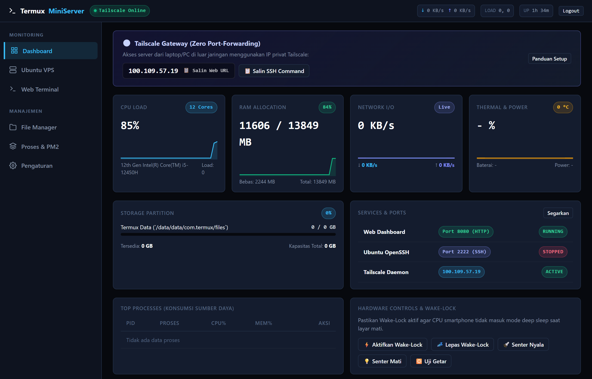
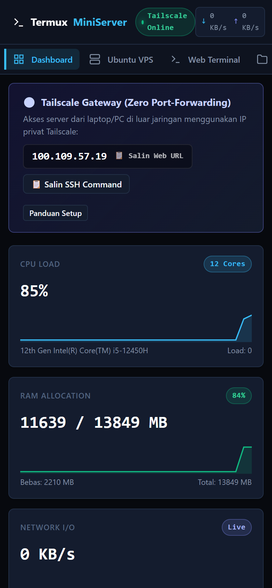
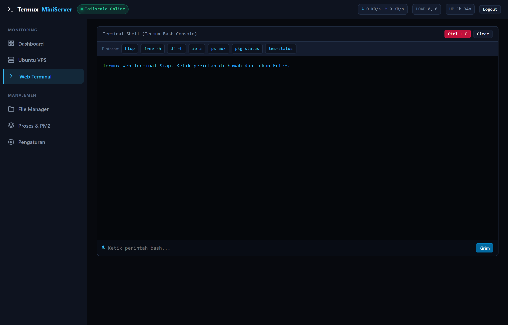
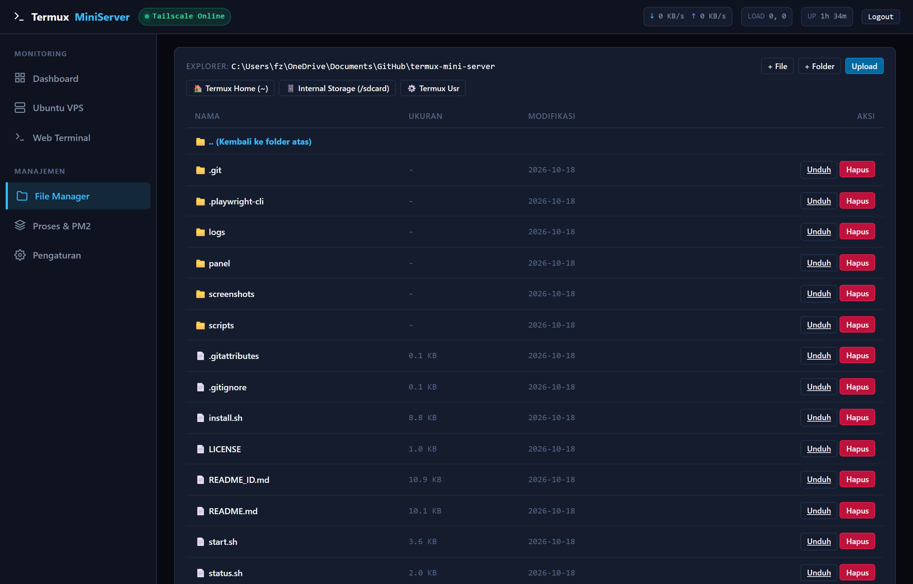

# 🚀 Termux Mini Server & Ubuntu VPS (Tailscale Edition)

<p align="center">
  
  
  
  
  
</p>

<p align="center">
  <strong>Transform any Android smartphone into a high-performance, energy-efficient Home Server & Ubuntu Linux VPS.</strong><br>
  Accessible securely from anywhere in the world via Tailscale private mesh VPN — no static public IP, port forwarding, or domain required.
</p>

<p align="center">
  <strong>English</strong> | <a href="README_ID.md">Bahasa Indonesia</a>
</p>

---

## 📖 Overview

**Termux Mini Server** is a complete, lightweight, and modern server solution designed to run seamlessly on Android devices using **Termux**. 

Unlike legacy community scripts that often break due to unmaintained binary tunnels (such as broken Cloudflare binaries on Android Bionic libc) or fragile package dependencies, this project is built from the ground up for **maximum stability, zero native build errors, and secure remote access**:
- **Tailscale Mesh VPN**: Direct, end-to-end encrypted access to your phone's web dashboard and Ubuntu SSH from your PC, laptop, or second phone, even behind cellular carrier CGNAT (4G/5G).
- **Zero-Dependency Node.js Backend**: Built strictly using Node.js core modules (`http`, `fs`, `os`, `child_process`, `crypto`, `net`). It requires **zero external npm compilations**, eliminating all ARM/ARM64 node-gyp build failures and consuming only ~25–35 MB of RAM.
- **Official `proot-distro` Ubuntu**: Employs Termux's official distribution manager for rock-solid stability, verified GPG keys, and clean updates.

---

## ✨ Features

* 🌐 **Modern Dark-Mode Web Dashboard (Port 8080)**
  * Sleek, mobile-friendly interface designed with high-contrast dark aesthetics.
  * Real-time hardware telemetry: CPU load %, RAM usage, Disk storage, SoC/CPU thermal sensors, and Battery status.
* 🔒 **Seamless Tailscale Remote Access**
  * Automatic detection of your Tailscale IP (`100.x.y.z`) and connection state.
  * One-click copying of remote Web Dashboard and SSH terminal URLs.
* 🖥️ **Full Ubuntu Linux VPS (Port 2222)**
  * Genuine Ubuntu environment running via PRoot (no root required).
  * Pre-configured OpenSSH Server listening on port `2222` with `root` and `ubuntu` user accounts.
  * Instant interactive terminal entry with the `ubuntu` command.
* 📁 **Built-in Web File Manager**
  * Browse Termux home (`~`) and Android shared storage (`/sdcard`).
  * In-browser code and text editor.
  * Multi-file streaming uploads and zipped directory downloads.
* 💻 **Web Bash Console / Streaming Terminal**
  * Execute bash commands directly from your browser.
  * Real-time chunked streaming output with interactive **Ctrl + C** job termination.
* ⚡ **Process Manager (PM2)**
  * Monitor and inspect background Node.js processes and server logs.
* 📱 **Hardware Quick Controls**
  * Toggle CPU wake-lock, flash torch, trigger vibration, and keep the phone awake 24/7.

---

## 📸 Interface Preview (UI/UX)

| 🖥️ Desktop Dashboard (Live Telemetry & Tailscale) | 📱 Mobile View (Responsive Layout) |
| :---: | :---: |
|  |  |

| 💻 Web Bash Console & Terminal | 📁 Web File Explorer & Text Editor |
| :---: | :---: |
|  |  |

---

## 🛠️ System Requirements

| Specification | Minimum | Recommended |
| :--- | :--- | :--- |
| **Operating System** | Android 7.0 (Nougat / SDK 24) | Android 10 s/d 14+ |
| **CPU Architecture** | ARM32 (`armhf`), ARM64 (`aarch64`), x86_64 | ARM64 (`aarch64`) |
| **RAM** | 512 MB | 2 GB or more |
| **Free Storage** | 1.5 GB | 3 GB+ (for apps & files) |
| **Root Status** | **No Root Required** | Works on both Rooted & Non-Rooted |

> ⚠️ **IMPORTANT**: Do **NOT** install Termux from Google Play Store! The Play Store build has been abandoned since 2020 and its package mirrors are completely non-functional. Always install Termux from **[F-Droid](https://f-droid.org/packages/com.termux/)** or **[GitHub Releases](https://github.com/termux/termux-app/releases)**.

---

## 🚀 Quick Start (1-Click Installation)

Open the **Termux** app on your phone, then copy and paste this command:

```bash
pkg update -y && pkg install git -y
git clone https://github.com/faizyoshio/termux-mini-server.git ~/termux-mini-server
cd ~/termux-mini-server
bash install.sh
```

### What `install.sh` Does Automatically:
1. Acquires Android storage permissions (`termux-setup-storage`) and enables CPU Wake-Lock (`termux-wake-lock`).
2. Installs essential host packages: `nodejs`, `openssh`, `proot`, `proot-distro`, `curl`, `wget`, `zip`, `unzip`, `tar`, `net-tools`.
3. Sets up the official Ubuntu rootfs via `proot-distro` and configures OpenSSH on port `2222`.
4. Installs global CLI helper shortcuts (`tms-server`, `tms-stop`, `tms-status`, `ubuntu`).
5. Cleans up package caches and automatically launches the server.

---

## 🔒 Tailscale Remote Access Setup

Tailscale creates an encrypted private mesh network (WireGuard-based) between your devices, allowing you to access your Android server from anywhere without exposing ports to the public internet.

```
+------------------------------------------------------------+
|                    Tailscale Private Mesh                  |
|                                                            |
|   Laptop / PC (Client)              Android Phone (Server) |
|   100.x.y.10                        100.x.y.20             |
|   [ Browser / SSH Client ]  =====>  [ Port 8080 (Web) ]    |
|                                     [ Port 2222 (SSH) ]    |
+------------------------------------------------------------+
```

### Step 1: On Your Android Phone
1. Install the official **[Tailscale App from Google Play Store](https://play.google.com/store/apps/details?id=com.tailscale.ipn)** or F-Droid.
2. Sign in with your Google, GitHub, Microsoft, or Apple account.
3. Toggle the connection switch to **Connected** (allow the Android VPN configuration).
4. Note the assigned Tailscale IP address (e.g., `100.85.12.34`).

### Step 2: On Your Laptop / Computer (Windows, macOS, Linux)
1. Download and install Tailscale from **[tailscale.com/download](https://tailscale.com/download)**.
2. Sign in with the **exact same account** used on your Android phone.
3. Connect Tailscale.

### Step 3: Access Your Server
* **Web Dashboard**: Open your laptop browser and navigate to:
  ```text
  http://<PHONE-TAILSCALE-IP>:8080
  ```
  *(Example: `http://100.85.12.34:8080`)*
* **Ubuntu VPS SSH**: Open your terminal (PowerShell, Command Prompt, macOS Terminal) and run:
  ```bash
  ssh root@<PHONE-TAILSCALE-IP> -p 2222
  ```
  *(Default password: `ubuntu123`)*

---

## 🔑 Default Credentials

| Service | Protocol / Port | Default Credentials |
| :--- | :--- | :--- |
| **Web Dashboard** | HTTP / Port `8080` | **Username**: `admin`<br>**Password**: `admin123` |
| **Ubuntu VPS (SSH)** | SSH / Port `2222` | **User**: `root` or `ubuntu`<br>**Password**: `ubuntu123` |

> 💡 *You can change your Web Dashboard username and password anytime via the **Settings** tab in the web panel.*

---

## ⌨️ CLI Shortcut Commands

Once installed, you can execute these commands from anywhere in your Termux terminal:

| Command | Action |
| :--- | :--- |
| `tms-server` | Launches both the Web Dashboard (port 8080) and Ubuntu VPS SSH (port 2222). |
| `tms-status` | Displays live service status, active ports, Local Wi-Fi IP, and Tailscale IP. |
| `tms-stop` | Safely terminates all panel and VPS processes. |
| `ubuntu` | Drops directly into the root terminal of your Ubuntu Linux VPS. |

---

## 📁 Repository Structure

```text
termux-mini-server/
├── install.sh                # 1-Click interactive installer
├── start.sh                  # Service launcher (Panel + VPS SSH)
├── stop.sh                   # Graceful service shutdown
├── status.sh                 # Status & IP diagnosis script
├── README.md                 # English documentation (Primary)
├── README_ID.md              # Indonesian documentation (Secondary)
├── panel/
│   ├── server.js             # Pure Node.js zero-dependency backend
│   ├── auth-config.json      # Administrator credentials storage
│   └── public/
│       └── index.html        # Single-page modern responsive web panel
└── scripts/
    ├── start-ubuntu.sh       # Ubuntu PRoot execution & SSH daemon script
    ├── setup-tailscale.sh    # Tailscale connectivity checker
    └── vps-init.sh           # Internal Ubuntu initial setup script
```

---

## ❄️ 24/7 Stability & Optimization Guide

If you intend to run your Android device as an uninterrupted, always-on server:

1. **Disable Android Battery Restrictions**:
   * Go to Android *Settings* -> *Apps* -> *Termux* -> *Battery* -> Select **Unrestricted / No Restrictions**.
   * Perform the same step for the **Tailscale** app.
2. **Ensure Wake-Lock is Active**:
   * The installer automatically enables wake-lock, preventing the Android OS from putting the CPU into deep sleep when the screen turns off.
3. **Android 12+ (Phantom Process Killer Fix)**:
   * Modern Android versions may kill background processes if they exceed a threshold. To prevent this, run this one-time ADB command from your PC:
     ```bash
     adb shell "/system/bin/device_config put activity_manager max_phantom_processes 2147483647"
     ```
4. **Thermal Management**:
   * Remove any protective phone case.
   * Place the phone in an upright position or use a cheap 5V USB cooling fan blowing against the back cover.
   * Use a reliable, certified charging cable to preserve battery health.

---

## 🤝 Contributing

Contributions, bug reports, and feature suggestions are welcome! Feel free to open an issue or submit a pull request on the [GitHub Repository](https://github.com/faizyoshio/termux-mini-server).

---

## 📄 License

This project is open-source and released under the [MIT License](LICENSE).  
Developed with ❤️ by [Faiz Yoshio](https://github.com/faizyoshio).
